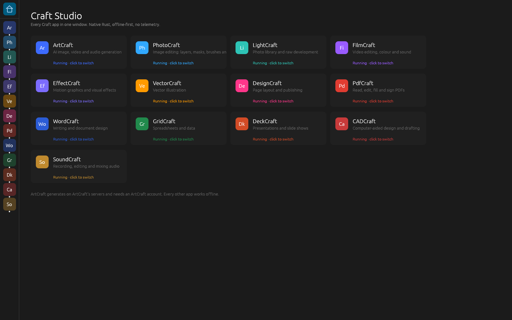

# Craft Studio

Every Craft app in one native window: a sidebar to switch apps, a home page, and the app in front.



| Module      | App                                   | Works offline            |
|-------------|---------------------------------------|--------------------------|
| ArtCraft    | AI image, video and audio generation  | No: ArtCraft account     |
| PhotoCraft  | Image editing, layers, PSD            | Yes                      |
| LightCraft  | Photo library and raw development     | Yes                      |
| FilmCraft   | Video editing, colour and sound       | Yes                      |
| EffectCraft | Motion graphics and visual effects    | Yes                      |
| VectorCraft | Vector illustration                   | Yes                      |
| DesignCraft | Page layout and publishing            | Yes                      |
| PdfCraft    | Read, edit, fill and sign PDFs        | Yes                      |
| WordCraft   | Writing and document design           | Yes                      |
| GridCraft   | Spreadsheets and data                 | Yes                      |
| DeckCraft   | Presentations and slide shows         | Yes                      |
| CADCraft    | Computer-aided design and drafting    | Yes                      |
| SoundCraft  | Recording, editing and mixing audio   | Yes                      |

## Run it

Prerequisites: Rust 1.95 or later (`rustup update`).

| OS      | System packages                                                                 |
|---------|----------------------------------------------------------------------------------|
| Linux   | `sudo apt install build-essential pkg-config libasound2-dev libxkbcommon-dev libwayland-dev libx11-dev libxi-dev libgl1-mesa-dri` (Debian/Ubuntu) |
| macOS   | Xcode Command Line Tools (`xcode-select --install`)                             |
| Windows | Visual Studio Build Tools, "Desktop development with C++"                       |

```bash
git clone --recurse-submodules --shallow-submodules https://github.com/maximemarc/cloudtools
cd cloudtools
cargo run --release -p craft-studio                       # every app (first build: 20–40 min)
cargo run --release -p craft-studio -- --app photocraft    # open straight into an app
cargo run --release -p craft-studio -- --list             # app ids
cargo run --release -p craft-studio --no-default-features --features photocraft,pdfcraft  # a smaller build
cargo build --profile dist -p craft-studio                # optimised binary in target/dist/
```

Chinese and Japanese fonts are not embedded by default: each app embeds its own copy of
[craft-fonts](../upstream/craft-fonts), which adds about 350 MB to the binary. Without them the
apps use the system's CJK fonts (LightCraft shows boxes for CJK text). To embed them:

```bash
CRAFT_FONTS_DIR="$PWD/upstream/craft-fonts" cargo build --release -p craft-studio
```

`RUST_LOG=debug` raises the log level. Settings, recovery files and libraries live where each
standalone app keeps them, so the Studio and the standalone apps share them.

## How it is built

```text
apps/craft-studio          the shell: window, sidebar, home page, app switching
crates/studio-core         the contract: ModuleInfo, Create, request_close
crates/studio-overlay      build-time rewrite of an upstream binary's sources (see below)
crates/modules/<app>       one adapter per app: Cargo.toml (generated), lib.rs, upstream/studio.rs
upstream/<app>             the upstream code, untouched apart from patches/
```

- **One dependency graph.** The root workspace depends on every app's crates by path. All apps use
  the same eframe/egui 0.36.2, wgpu 30 and winit 0.30.13, so they share one window, one GPU device
  and one event loop. PdfCraft's hardened `hayro`, `lopdf`, `winit` and `egui-wgpu` forks apply to
  every app (`[patch.crates-io]`).
- **Adapters reuse the upstream glue.** An app's window glue (file dialogs, preferences, audio,
  recovery) sits in its binary crate next to `fn main`, where no other crate can call it.
  `studio-overlay` rewrites those sources into `OUT_DIR` at build time (drops `fn main` and the
  tests, resolves `mod`, `crate::`, `env!` and `include_bytes!` paths) and the adapter includes
  them as a private module. `upstream/studio.rs` is a child of that module, so it calls the
  upstream helpers directly; it only replaces what `main` did with the `CreationContext`.
- **Apps start when first opened** and keep running in the background (documents, undo, jobs);
  only the app in front gets frames and input. Each app's egui-wide state (fonts, theme, zoom) is
  swapped with it, so one app's look never leaks into another.
- **Quit stays inside the app.** File › Quit in an app closes that app (it saves what it keeps on
  quitting) and returns home; closing the window quits the Studio.

## Compared with the standalone apps

Not in the Studio (use the standalone apps or their CLIs for these):

- control channels and MCP bridges (`--control`, `*-cli mcp`), command-line file opening;
- macOS system menu bars (the in-window menus are used), Finder/Dock open events, single
  instance;
- the GPU start-up fallbacks of the standalone launchers (the Studio starts on wgpu; set
  `WGPU_BACKEND=gl` on machines where the default backend fails).

Closing the Studio window asks only the app in front about unsaved changes. Apps in the
background save their preferences; DesignCraft, DeckCraft, FilmCraft, EffectCraft, PdfCraft and
VectorCraft also keep crash-recovery copies and offer them back on the next start.

## Network and privacy

No module sends telemetry. Network use is on demand only: ArtCraft's generation API (when signed
in), PdfCraft's Help › Check for Updates, and AI model downloads in LightCraft and EffectCraft
(checksummed). See [artcraft/EXTERNAL-CALLS.md](artcraft/EXTERNAL-CALLS.md).

## After an upstream sync

Check a build end to end (every app opened in turn, one screenshot each, exit status 1 if an
app fails to start or panics). CI ([`.github/workflows/craft-studio.yml`](../.github/workflows/craft-studio.yml))
runs it on every push: under `xvfb-run` on Linux, where it gates the build, and as a best-effort
run on the GPU-less macOS and Windows runners. The screenshots are the `smoke-<OS>` artifacts.

```bash
cargo run --release -p craft-studio -- --smoke /tmp/craft-studio-smoke
```

```bash
./scripts/upstream-sync.sh                       # vendor, apply patches/, fix lockfiles
python3 -I scripts/gen-module-manifests.py      # adapter dependencies from the upstream binaries
cargo check -p craft-studio                      # a failing adapter points at what changed in main.rs
cargo audit                                      # .cargo/audit.toml documents the accepted advisory
```
